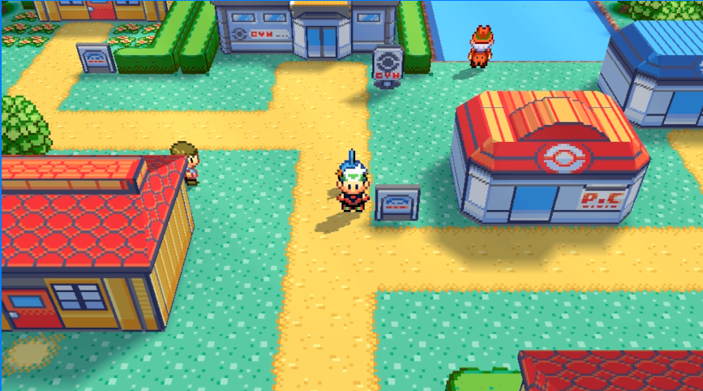

# Pokémon Emerald Voxel: PS Vita Port

A native PlayStation Vita port (`PKEV00001`) of the `pokeemerald-multiplatform` decompilation. Game logic runs directly on the Vita's Cortex-A9 CPU (not an emulator) and holds a locked **60 FPS** at the default `222 MHz` ARM clock in both classic **2D GBA** mode and live **3D voxel** overworld mode.

<a href="https://www.buymeacoffee.com/arfatnaik0" target="_blank">
  
</a>

| 2D Mode (`816×544` 3:2 / `960×544` Wide) | 3D Voxel Overworld (`vitaGL`) |
| :---: | :---: |
|  |  |

> **Data-free repository:** Contains no ROMs, Nintendo/Game Freak assets, compiled ELFs/VPKs, or third-party sprite/voxel packs (see [SECURITY_OR_ASSET_POLICY.md](SECURITY_OR_ASSET_POLICY.md)). You must supply your own legally dumped Pokémon Emerald `.gba` ROM and build locally with VitaSDK.

---

## Features & Controls

- **Instant 2D / 3D Switching:** Press **Square (`□`)** anywhere in the overworld to toggle between 2D GBA rendering and the hardware-accelerated 3D voxel diorama. Battles, menus, unmapped interiors, and transitions automatically use 2D.
- **Aspect Ratio Toggle:** Press **Triangle (`△`)** to switch between stretched widescreen (`960×544`) and pixel-accurate `3:2` (`816×544`).
- **Follower Pokémon:** Supports external `FMN1` sprite packs loaded from `app0:followers/` or `ux0:data/pokeemerald/followers/`.
- **Low-Overhead Audio (`42060 → 44100 Hz`):** Runs M4A/CGB synths at native `42060 Hz` using a CGB phase cache, clamped/NaN-safe BDPCM decoding, and NEON SIMD mixing (`0.40f` gain), followed by a single resample pass to `44100 Hz` (`port/vita/patches/sdl2-vita-audio-42060.patch`).
- **Storage & Diagnostics:** Saves (`pokeemerald.sav`), config (`pokeemerald.cfg`), frame timings (`perf.log`), and GL diagnostics (`vitagl_error.log`) are stored in `ux0:data/pokeemerald/`.

| PS Vita Input | Action |
| --- | --- |
| D-Pad / Left Stick | Move, navigate menus |
| Cross (`×`) / Circle (`○`) | GBA **A** / **B** |
| Start / Select | GBA **Start** / **Select** |
| L / R | GBA **L** / **R** |
| Square (`□`) | Toggle 2D / 3D voxel overworld |
| Triangle (`△`) | Toggle widescreen (`960×544`) / `3:2` (`816×544`) |

---

## Technical Architecture

- **3D Voxel Renderer (`port/src/platform/voxel/`):** Adapted from `ZallaxDev/emerald-3ds` and `HctrRB/pokeemerald-vita-3ds`. Renders polygonal buildings with roof cutaways (`buildings.bin`, `PortDoor_Get`), continuous terrain/slopes/ledges (`relief.bin`, `regions.bin`), billboard trees (`trees.rgba5551`), wooden signposts (`signposts.bin`), and rustling 3D tall/ash/long grass with leaf particles. Uses fixed-function `vitaGL` (`_glDrawArrays_FixedFunctionIMPL` + ping-pong uniform arena, no runtime shader compilation) with a `BG0` 2D UI overlay (`Pass_Overlay2D`) while `RunFrameLineEvents` keeps raster and audio in sync. See [ARCHITECTURE.md](ARCHITECTURE.md) and [port/docs/VITA_VOXEL_VISUAL_LIMITATIONS.md](port/docs/VITA_VOXEL_VISUAL_LIMITATIONS.md).
- **Multi-Core GBA PPU (`gba_easy_draw.c`, `gba_easy_draw_workers.c`):** Splits 160 scanlines into dynamic 8-line chunks across the render thread and 2 workers (pinnable to cores `0–2` via `VITA_PIN_RENDER_THREADS=ON`), supports parallel `WIN0H` HBlank DMA (`VITA_ENABLE_HBLANK_WIN0_PARALLEL=ON`), composites `4bpp`/`8bpp` and `BGR555→RGB565` in ARM NEON into an 8-slot CDRAM texture ring (`sGameTextureRing`), and avoids software modulo divisions on overworld mosaic layers via `(REG_MOSAIC & 0xF) == 0` and `ApplyMosaicFloorU()`.
- **Clock Management:** Calls `scePowerSetArmClockFrequency(222)` at startup and resume (enough headroom exists for `166 MHz` as well). Kernel plugins like PSVshell can override this; `perf.log` logs before/after frequencies.

---

## Building Locally

### Prerequisites

1. **ROM:** Legal Pokémon Emerald (USA, Europe) Rev 0 `.gba` (`BPEE`, `16,777,216` bytes, SHA-1 `f3ae088181bf583e55daf962a92bb46f4f1d07b7`) placed in `./ROM/`.
2. **Base Source (`./pokeemerald`):** Clone [`gradenGnostic/pokeemerald-multiplatform`](https://github.com/gradenGnostic/pokeemerald-multiplatform) into `./pokeemerald`.
   - *Patch note:* `port/patches/upstream-vita-hooks.patch` diffs cleanly against local baseline commit `15c5805`. On a fresh public clone, manually merge its hunks into `include/{battle_transition,decoration,overworld,platform,shop,sprite}.h` and `src/{battle_transition,decoration,event_object_movement,field_camera,field_door,field_effect_helpers,music_player,overworld,shop,sound_mixer,sprite,tileset_anims}.c`.
3. **Toolchains & Libraries:**
   - [VitaSDK](https://vitasdk.org/) (verified with `vita-toolchain c527abce`, `vita-headers ebc8f4f7`, `newlib 64aa7aa3`, `pthread-embedded 11d2e572`).
   - SDL2 `2.30.7` source tarball (patched in Step 5).
   - [`vitaGL`](https://github.com/Rinnegatamante/vitaGL) built with `-DHAVE_SHADER_CACHE -DSKIP_SPLASHSCREEN -DSTRICT_DRAW_COMPLIANCE -DUNIFORM_PINGPONG -DALIGNED_POOL -DDRAW_SPEEDHACK -DINDICES_SPEEDHACK -DSAMPLERS_SPEEDHACK -DGXM_STATE_CACHE` (`VITAGL_ROOT`). Non-VBO draws use a 6-frame `vglMemalign` stream ring in `voxel_renderer.c` to satisfy `-DDRAW_SPEEDHACK`.
   - Host build tools (`gcc`/`g++`, `make`, `cmake`, `ninja`, `python3`, native SDL2/OpenGL dev libs, or `VITA_M0_DOCKER_IMAGE`).
4. **External Asset Packs (User-Generated):**
   - `voxel/` (`buildings.bin`, `regions.bin`, `relief.bin`, `signposts.bin`, `trees.rgba5551`): Generate from your ROM using the host scripts in [`ZallaxDev/emerald-3ds`](https://github.com/ZallaxDev/emerald-3ds) (`>= 0.5.0`, see its `ASSET_PIPELINE.md`), supplemented by [port/tools/extract_voxel_layout_models.py](port/tools/extract_voxel_layout_models.py) for `VBL4` layout models. To build 2D-only without a voxel pack, pass `-DVITA_ENABLE_VOXEL=OFF -DVITA_PACKAGE_VOXEL_ASSETS=OFF`.
   - `followers/` (`FMN1` sprite pack): Optional. Disable with `-DVITA_ENABLE_FOLLOWER=OFF` or load externally with `-DVITA_PACKAGE_FOLLOWER_ASSETS=OFF`.

### Build & Install Steps

1. **Verify your ROM:**
   ```sh
   python3 scripts/verify_rom.py "ROM/Pokemon - Emerald Version (USA, Europe).gba"
   ```

2. **Apply the port overlay and hook patch** (cleans stale `src/platform/{voxel,vita}` files first):
   ```sh
   bash scripts/apply_port.sh --apply-patch
   ```

3. **Build host tools, M0 intermediates, and run host tests:**
   ```sh
   make -C pokeemerald -f make_tools.mk tools
   make -C pokeemerald -f Makefile_pc linux -j"$(nproc)"
   bash scripts/apply_port.sh --run-tests
   ```

4. **Generate LiveArea 8-bit indexed PNGs** (falls back to geometric placeholders if ImageMagick or `./assets/` images are absent):
   ```sh
   bash pokeemerald/vita/prepare_livearea_assets.sh
   ```

5. **Build the audio-patched SDL2 (one-time setup):**
   ```sh
   export VITASDK=/path/to/vitasdk
   export PATH="$VITASDK/bin:$PATH"
   SDL2_SOURCE=/path/to/SDL2-2.30.7 bash pokeemerald/vita/scripts/build_audio_optimized_sdl2.sh
   ```

6. **Compile and audit the VPK** (outputs to `local-output/test-build-checkpoints/`; both modes embed base game data in `eboot.bin`, so keep VPKs local):
   ```sh
   export VITAGL_ROOT=/path/to/vitagl-fixed-function

   # Option A: Slim VPK (loads voxel/ and followers/ from ux0:data/pokeemerald/ at runtime)
   VITA_PACKAGE_VOXEL_ASSETS=OFF VITA_PACKAGE_FOLLOWER_ASSETS=OFF \
     bash ./pokeemerald/vita/build_vita_ab.sh slim-vpk

   # Option B: Self-contained VPK (bundles local voxel/ and followers/ into app0:)
   VOXEL_ASSETS_DIR=/path/to/local/voxel FOLLOWER_ASSETS_DIR=/path/to/local/followers \
     bash ./pokeemerald/vita/build_vita_ab.sh voxel-222mhz
   ```

7. **Install on PS Vita:**
   - Copy the `.vpk` to `ux0:downloads/pokemon-emerald-voxel.vpk` and install it via **VitaShell**.
   - If using **Option A**, copy your `voxel/` and optional `followers/` directories to `ux0:data/pokeemerald/voxel/` and `ux0:data/pokeemerald/followers/`.

8. **Verify repo hygiene before committing:**
   ```sh
   python3 scripts/preflight_data_free.py
   ```

---

## Repository Structure

```text
.
├── README.md                        # Overview, controls, build guide
├── ARCHITECTURE.md                  # Deep developer architecture & pipeline reference
├── LICENSE                          # Scoped licenses (MIT runtime; CC BY-NC-SA 4.0 voxel/)
├── NOTICE.md                        # Upstream provenance and attributions
├── SECURITY_OR_ASSET_POLICY.md      # Data-free policy rules
├── port/
│   ├── src/platform/                # SDL2 Vita backend, NEON PPU, CGB audio, Voxel renderer
│   ├── include/platform/            # Platform, pacing, perf & snapshot headers
│   ├── vita/                        # CMakeLists, VitaSDK scripts, SDL2 patch, LiveArea XML
│   ├── tests/platform/              # Host parity, PPU perf, pacing, audio & input tests
│   ├── patches/                     # Hook diff against upstream pokeemerald C/H files
│   ├── tools/                       # VBL4 voxel layout model extractor
│   └── docs/                        # Voxel visual limitations & cutaway notes
└── scripts/
    ├── apply_port.sh                # Syncs port/ into ./pokeemerald & runs host tests
    ├── preflight_data_free.py       # Ensures no ROMs/assets/builds are staged in Git
    └── verify_rom.py                # Verifies Emerald (USA, Europe) Rev 0 ROM SHA-1
```

---

## Legal & Credits

- **Disclaimer:** Unofficial fan port for education and preservation. Pokémon, Pokémon Emerald, and all related assets and trademarks belong to Nintendo, Creatures Inc., and GAME FREAK inc. No copyrighted ROMs, game assets, or compiled binaries are distributed here.
- **Licensing (see [LICENSE](LICENSE) & [NOTICE.md](NOTICE.md)):**
  - **MIT:** Original PS Vita runtime, PPU, audio, tests, build scripts, retained `pokeemerald-multiplatform` port changes, and `HctrRB` compatibility shims/`vita_daynight.c`/`voxel_vita_bridge.c`.
  - **CC BY-NC-SA 4.0:** 3D voxel diorama subsystem under `port/src/platform/voxel/*` (derived from `ZallaxDev/emerald-3ds >= 0.5.0` and `HctrRB/pokeemerald-vita-3ds`, excluding the MIT files noted above).
  - **Upstream & Dependencies:** Unmodified `bios.c` and patch context lines retain upstream `GPL-2.0` / `MPL-2.0` terms; `vitaGL` is `LGPL-3.0-or-later` / `GPL-3.0`; `SDL2` is `zlib`.
- **Credits:**
  - [pret/pokeemerald](https://github.com/pret/pokeemerald) — Pokémon Emerald decompilation.
  - [`gradenGnostic/pokeemerald-multiplatform`](https://github.com/gradenGnostic/pokeemerald-multiplatform) (`Kurausukun`, `NT_x86`, `Normmatt`, `camthesaxman`, contributors) — SDL2 multiplatform foundation, `gba_easy_draw`, and portable audio.
  - [`HctrRB/pokeemerald-vita-3ds`](https://github.com/HctrRB/pokeemerald-vita-3ds) (`HctrRB`) — PS Vita `vitaGL` voxel port, `vita_daynight.c`, and Vita hooks.
  - [`ZallaxDev/emerald-3ds`](https://github.com/ZallaxDev/emerald-3ds) (`Zallax`, contributors, `poke-corpus`, `pokeheartgold`) — 3D voxel diorama architecture and Gen-4 follower sprite corpus.
  - [VitaSDK](https://vitasdk.org/), [vitaGL](https://github.com/Rinnegatamante/vitaGL), and [SDL2](https://www.libsdl.org/).