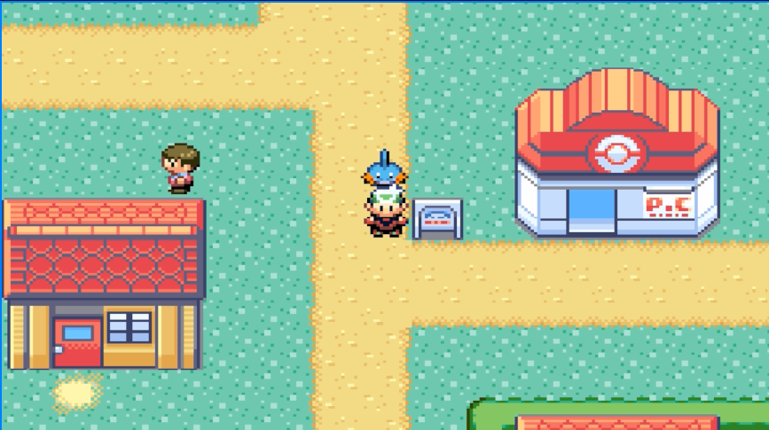

# Pokémon Emerald Voxel: PS Vita Port

| 2D Mode (`816×544` 3:2 / `960×544` Wide) | 3D Voxel Overworld (`vitaGL`) |
| :---: | :---: |
|  |  |

Native PlayStation Vita port of Pokémon Emerald based off [`pokeemerald-multiplatform`](https://github.com/gradenGnostic/pokeemerald-multiplatform) with a hardware-accelerated 3D voxel overworld powered by `vitaGL`.

## Features

- Locked **60 FPS** at the default `222 MHz` ARM clock in both 2D GBA mode and 3D voxel overworld mode.
- Hardware-accelerated 3D voxel overworld with polygonal buildings, roof cutaways, continuous terrain, billboard trees, signposts, and rustling grass.
- Automatic fallback to 2D GBA rendering for battles, menus, unmapped interiors, and transitions.
- Support for `816×544` (`3:2` pixel-accurate) and `960×544` (widescreen) display modes.
- Follower Pokémon support via external `FMN1` sprite packs.
- Low-overhead native `42060 Hz` synth audio resampled to `44100 Hz`.
- Saves, config, and logs stored in `ux0:data/pokeemerald/`.

## Controls

- **D-Pad / Left Stick:** Move, navigate menus.
- **Cross (`×`) / Circle (`○`):** GBA **A** / **B**.
- **Start / Select:** GBA **Start** / **Select**.
- **L / R:** GBA **L** / **R**.
- **Square (`□`):** Toggle between 2D GBA mode and 3D voxel overworld.
- **Triangle (`△`):** Toggle between `3:2` (`816×544`) and widescreen (`960×544`).

## How to Install

> This is a data-free repository and contains no ROMs, game assets, or compiled binaries (see [SECURITY_OR_ASSET_POLICY.md](SECURITY_OR_ASSET_POLICY.md)).

- Build the `.vpk` locally using your own legally dumped Pokémon Emerald (USA, Europe) Rev 0 `.gba` ROM by following the full instructions in [DETAILS.md](DETAILS.md).
- Copy the compiled `.vpk` to `ux0:downloads/pokemon-emerald-voxel.vpk` and install it via **VitaShell**.
- If using the slim VPK, place your generated `voxel/` and optional `followers/` directories into `ux0:data/pokeemerald/voxel/` and `ux0:data/pokeemerald/followers/` (or `app0:followers/`).

For technical architecture, full build steps, repository structure, and licensing details, see [DETAILS.md](DETAILS.md) and [ARCHITECTURE.md](ARCHITECTURE.md).

## Credits

- [pret/pokeemerald](https://github.com/pret/pokeemerald) — Pokémon Emerald decompilation.
- [`gradenGnostic/pokeemerald-multiplatform`](https://github.com/gradenGnostic/pokeemerald-multiplatform) (`Kurausukun`, `NT_x86`, `Normmatt`, `camthesaxman`, contributors) — SDL2 multiplatform foundation, `gba_easy_draw`, and portable audio.
- [`HctrRB/pokeemerald-vita-3ds`](https://github.com/HctrRB/pokeemerald-vita-3ds) (`HctrRB`) — PS Vita `vitaGL` voxel port, `vita_daynight.c`, and Vita hooks.
- [`ZallaxDev/emerald-3ds`](https://github.com/ZallaxDev/emerald-3ds) (`Zallax`, contributors, `poke-corpus`, `pokeheartgold`) — 3D voxel diorama architecture and Gen-4 follower sprite corpus.
- [VitaSDK](https://vitasdk.org/), [vitaGL](https://github.com/Rinnegatamante/vitaGL), and [SDL2](https://www.libsdl.org/).
